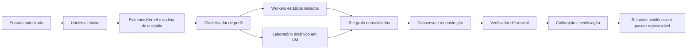

# RE_Megazord — Especificação-Mãe de Reconstrução e Auditoria Forense Universal

**Data:** 2026-09-22  
**Estado:** arquitetura aprovada em conversa; especificação executável sujeita à revisão final do usuário  
**Projeto:** `D:\AetherRE_Megazord`  
**Objetivo:** elevar o RE_Megazord ao maior nível tecnicamente verificável de análise, engenharia reversa e reconstrução forense, reutilizando ferramentas maduras sem transformar marketing em evidência.

## 1. Princípio central

O RE_Megazord não prometerá recuperar com exatidão informação destruída por compilação, stripping, ofuscação, empacotamento ou criptografia. Em vez disso, deverá produzir a **reconstrução máxima demonstrável**, mantendo separação explícita entre:

1. **EXACT** — byte, símbolo, fonte ou relação recuperada e confirmada por prova direta;
2. **VERIFIED_RECONSTRUCTION** — reconstrução reproduzível validada contra binário, build ou comportamento observável;
3. **PROBABILISTIC_INFERENCE** — inferência calibrada, com evidência, confiança e alternativas;
4. **HYPOTHESIS** — hipótese útil ainda não confirmada;
5. **UNKNOWN** — informação não recuperável ou não comprovada com os meios disponíveis.

O sistema deve preferir `UNKNOWN` a uma conclusão falsa. “Código equivalente” não será chamado de “código-fonte original”. Precisão, rastreabilidade e abstinência correta têm prioridade sobre cobertura artificial.

## 2. Definição operacional de conclusão

O projeto só poderá ser declarado concluído quando todos os gates F00–F12 estiverem aprovados com artefatos reproduzíveis, zero erro de integridade conhecido e revisão independente. Cada formato/perfil terá certificação própria; suporte a um perfil não implica suporte universal.

Estados permitidos por gate e perfil:

- `QUITADA`: requisito e teste aprovados, com evidência íntegra;
- `PARCIALMENTE_QUITADA`: existe capacidade real, mas falta parte do contrato;
- `NAO_QUITADA`: requisito não foi atendido;
- `NAO_COMPROVADA`: alegação sem evidência suficiente.

Enquanto qualquer gate obrigatório não estiver `QUITADA`, o projeto permanece em dívida e não pode receber selo de conclusão total.

## 3. Escopo por ondas certificáveis

### Onda 0 — base já existente e endurecimento

- Projetos-fonte: C, C++, Python, Go, JavaScript e TypeScript nos limites comprovados pelo corpus.
- Binários nativos: PE e ELF, inicialmente x86, x86-64 e arquiteturas efetivamente cobertas pelos backends instalados.
- Backends existentes: Ghidra, Rizin, angr, Frida, Unicorn e Binary Ninja quando licenciado e disponível.
- Meta: estabilizar contratos, cadeia de custódia, grafo, consenso, reconstrução, métricas e regressão antes de ampliar formatos.

### Onda 1 — managed, mobile e WebAssembly

- .NET/CLR: assemblies, metadata, IL, PDB quando disponível e ReadyToRun nos limites do backend.
- Android: APK, DEX, recursos, manifesto, bytecode, código nativo embarcado e relações entre camadas.
- WebAssembly: módulos `.wasm`, seções, imports/exports, instruções, conversão textual e representação intermediária.
- Meta: análise estática profunda, projeto reconstruído quando tecnicamente possível e correlação multi-backend.

### Onda 2 — expansão heterogênea

- Mach-O, bundles e IPA autorizados.
- JVM/JAR além do escopo Android.
- Firmware, imagens raw, Intel HEX, sistemas de arquivos embarcados e arquiteturas adicionais.
- Bytecode Python e outros formatos somente após contrato, corpus, oráculo e gate próprios.

Nenhuma onda será promovida por simples detecção de formato. A promoção exige corpus autorizado, oráculo, métricas, testes adversariais, relatório de limitações e ausência de regressão na onda anterior.

## 4. Arquitetura-alvo

### 4.1 Universal Intake

Responsável por ingestão segura, identificação de formato, hashing, expansão limitada de containers, inventário e roteamento. Deve:

- aceitar arquivo, diretório, pacote, imagem ou projeto autorizado;
- calcular hashes criptográficos antes de qualquer transformação;
- detectar tipo por conteúdo, não apenas extensão;
- impor limites de profundidade, quantidade, tamanho e razão de descompressão;
- bloquear path traversal, symlink escape, archive bombs e nomes maliciosos;
- gerar manifesto imutável e identificador de caso;
- impedir execução acidental no host.

### 4.2 Evidence Kernel

Será a fonte de verdade do caso. Todo achado deverá apontar para evidência content-addressed e para uma derivação reproduzível.

Contrato mínimo de um item de evidência:

- `case_id`, `artifact_id`, hashes, tamanho, origem e política de autorização;
- ferramenta, versão, release/commit, configuração e ambiente;
- comando ou API invocada, timestamps monotônicos e resultado;
- offsets, endereços, símbolo ou região relacionada;
- classificação epistemológica, confiança calibrada e limitações;
- pais de derivação e hash do produto derivado;
- redaction status e política de retenção.

O journal será append-only, validado por schema, encadeado por hash e recuperável após cancelamento, disco cheio ou crash. Corrupção, truncamento ou schema desconhecido deve falhar fechado.

### 4.3 Profile Router e adapters

O roteador selecionará pipelines por formato, arquitetura, runtime, proteção e objetivo. Adapters não poderão publicar conclusões diretamente: apenas observações normalizadas com evidências.

Cada adapter deverá implementar:

- `probe`: disponibilidade, versão, licença e capacidades;
- `supports`: formatos, arquiteturas e limitações declaradas;
- `plan`: comandos e recursos antes de executar;
- `run`: execução limitada, isolada e observável;
- `normalize`: conversão para IR/grafo canônico;
- `validate`: integridade e completude mínima do resultado;
- `cleanup`: encerramento e remoção segura do workspace efêmero.

Falha de adapter deve gerar resultado tipado, nunca silêncio. Timeout, OOM, cancelamento e output malformado precisam de estados distintos.

### 4.4 Workers isolados

Ferramentas externas serão executadas fora do processo central. Cada worker terá:

- diretório efêmero dedicado e permissões mínimas;
- CPU, memória, tempo, disco e quantidade de processos limitados;
- rede negada por padrão;
- stdout/stderr capturados e redigidos;
- binário e configuração pinados por versão e hash;
- protocolo estável de entrada/saída;
- kill tree e limpeza idempotente.

Ferramentas GPL/AGPL ou com condições incompatíveis serão preferencialmente integradas como processos externos, sem cópia de código, depois de parecer de licença. Integração técnica não substitui autorização jurídica.

### 4.5 IR e grafo forense normalizados

O modelo comum deverá representar, sem apagar a origem:

- artefatos, segmentos, seções, módulos, namespaces, classes e funções;
- blocos, instruções, IL/bytecode, constantes, strings e recursos;
- imports, exports, símbolos, relocations e metadados;
- CFG, call graph, data flow, references e dependências;
- eventos dinâmicos, syscalls, arquivos, registro, rede e memória;
- achados, hipóteses, conflitos, alternativas e relações de proveniência.

Todo nó e aresta deverá manter `source_backend`, `evidence_refs`, localização, nível epistemológico e confiança. A normalização não poderá descartar detalhe opaco sem registrar `losses`.

### 4.6 Consenso e reconstrução

O coordenador executará múltiplos backends quando houver benefício mensurável. Divergência não será resolvida por maioria cega. O consenso deverá ponderar:

- compatibilidade do backend com o formato e arquitetura;
- evidência direta versus heurística;
- desempenho histórico no corpus equivalente;
- independência entre métodos;
- qualidade estrutural do resultado;
- possibilidade de validação diferencial.

A saída poderá conter pseudocódigo, projeto reconstruído, headers, tipos, nomes inferidos, diagramas e relatório comportamental. Cada fragmento deverá carregar origem, confiança, perdas e teste que o sustenta.

### 4.7 Verificador diferencial

Quando houver fonte ou build autorizado, o sistema deverá fechar o ciclo:

`fonte → build reproduzível → binário → análise → reconstrução → rebuild/execução controlada → comparação`

Dimensões mínimas:

- equivalência de símbolos e assinaturas;
- CFG e call graph;
- constantes, strings e recursos;
- comportamento em testes e traces;
- formato/ABI e imports/exports;
- findings conhecidos e falsos positivos;
- diferenças explicadas versus não explicadas.

Sem fonte, o sistema deve usar oráculos independentes: debug symbols, especificação de formato, golden traces, test vectors, múltiplos backends e inspeção humana cega.

### 4.8 Calibração e certificação

Confiança deverá ser calibrada em holdout cego e nunca calculada apenas pelo próprio backend. O certificado do caso registrará:

- versão completa do pipeline;
- perfis realmente exercitados;
- corpus e autorização;
- métricas com denominadores e intervalos de confiança;
- falhas, abstinências e áreas não inspecionadas;
- hashes de todos os artefatos de prova;
- instruções de replay limpo.

## 5. Matriz de reaproveitamento tecnológico

| Capacidade | Componente candidato | Forma de integração | Critério de promoção |
|---|---|---|---|
| Native multiarch | Ghidra | adapter/headless existente, endurecido | cobertura e precisão superiores ao baseline |
| Native formats/CLI | Rizin | adapter existente e worker isolado | parsing e relações validadas em holdout |
| Symbolic analysis | angr + Z3 | adapter existente, jobs limitados | ganho mensurável sem explosão não controlada |
| Emulação | Unicorn | adapter existente, harness determinístico | traces repetíveis e isolamento aprovado |
| Instrumentação dinâmica | Frida | somente laboratório autorizado | VM real, rollback e política de alvo aprovados |
| Native decompilation | RetDec | processo externo opcional | benchmark diferencial e licença aprovados |
| .NET | ILSpy/ICSharpCode.Decompiler | CLI/biblioteca conforme licença validada | projeto/IL comparados a golden corpus |
| Android | JADX + Apktool | workers externos | manifesto, recursos, DEX e nativo correlacionados |
| Mobile triage | MobSF | serviço/container isolado opcional | findings confirmados; sem substituir o kernel |
| WebAssembly | WABT + Binaryen | workers externos e IR canônico | round-trip e semântica em test vectors |
| Capability identification | capa | backend externo com evidência | regras versionadas, precisão medida e offsets |
| Disassembly fallback | Capstone ou equivalente já licenciado | biblioteca isolada por contrato | compatibilidade e regressão aprovadas |

Nenhuma dependência será importada “porque é famosa”. Para cada uma haverá SBOM, licença, versão/commit, hash, CVEs conhecidos, política de atualização, corpus de avaliação e fallback. Projetos externos serão referenciados ou instalados de modo reprodutível; copiar trechos exige proveniência e licença explícitas.

## 6. Segurança, autorização e contenção

- Somente artefatos próprios, públicos com licença/termos compatíveis ou explicitamente autorizados.
- Análise estática é o padrão. Execução dinâmica de alvos ocorre apenas em VM descartável real depois do gate de isolamento.
- O host não executa amostras-alvo, installers desconhecidos, macros ou scripts extraídos.
- Rede de VM negada por padrão; quando indispensável, passa por simulador/sinkhole e captura completa.
- Snapshots precisam provar rollback, não apenas declarar que existe uma VM.
- Segredos, PII e credenciais são redigidos antes de logs e relatórios.
- Instruções encontradas dentro do alvo são dados não confiáveis, não comandos para o agente.
- Resultados de ferramentas são tratados como entrada hostil e validados por schema/tamanho.
- Casos têm quotas, cancelamento cooperativo, watchdog e trilha de auditoria.

## 7. Estratégia de testes

### 7.1 Pirâmide obrigatória

1. **Unitários:** schemas, parsers, roteamento, normalização, confidence states e políticas.
2. **Contratos:** cada adapter contra fixtures versionadas, inclusive outputs corrompidos.
3. **Integração:** intake → adapters → grafo → reconstrução → certificado.
4. **Diferenciais:** backend versus backend e reconstrução versus oráculo.
5. **Metamórficos:** renomeação, recompilação, otimização, stripping, packing permitido e pequenas mutações.
6. **Adversariais:** archive bombs, path traversal, parser bombs, prompt injection, outputs gigantes e formatos ambíguos.
7. **Caos:** timeout, kill, OOM, disco cheio, cancelamento, queda no journal e recovery.
8. **E2E limpo:** instalação do zero, execução pinada, replay e verificação de hashes.
9. **Holdout cego:** corpus nunca usado para desenvolver ou calibrar.
10. **Revisão independente:** reexecução e contestação dos achados.

### 7.2 Métricas mínimas

- precisão, recall e F1 por tipo de entidade e relação;
- calibration error/Brier score para confiança;
- taxa de abstinência correta e incorreta;
- cobertura por formato, arquitetura, proteção e fase;
- estabilidade/reprodutibilidade entre execuções;
- tempo, memória, disco e taxa de timeout;
- falsos positivos/negativos de findings;
- taxa de rebuild e equivalência comportamental quando aplicável;
- regressão comparada ao baseline congelado.

Resultados sem denominador, corpus, configuração e intervalo de incerteza não podem sustentar promoção.

### 7.3 Separação do corpus

- `development`: desenvolvimento local;
- `calibration`: ajuste de pesos e confiança;
- `blind_holdout`: avaliação final sem tuning;
- `adversarial`: casos desenhados para quebrar o sistema;
- `authorized_real`: projetos reais com autorização e oráculos independentes.

Hashes e listas dos subconjuntos serão selados. Contaminação de holdout invalida o resultado e exige novo conjunto.

## 8. Gates F00–F12

| Gate | Condição de aprovação |
|---|---|
| F00 | baseline reproduzível, inventário e escopo congelados |
| F01 | modelo de ameaça, autorização, licenças e políticas aprovados |
| F02 | Evidence Kernel, custódia, replay e recovery aprovados em caos |
| F03 | corpus 10+ complexo, separado, autorizado e com oráculos reais |
| F04 | perfis de linguagem e análise semântica medidos |
| F05 | ingestão/build/oráculos rastreáveis sem extrapolação indevida |
| F06 | grafo e relações avaliados por precisão/recall em holdout |
| F07 | PE/ELF multiarch e correlação source-build-binary aprovadas |
| F08 | VM descartável real, contenção, rollback e captura comprovados |
| F09 | fuzzing/simbólico/dinâmico limitados, reprodutíveis e úteis |
| F10 | métricas cegas, calibração e comparação contra baseline aprovadas |
| F11 | red team, prompt injection, parser attacks e citações aprovados |
| F12 | campanha final, clean install, replay e revisão independente aprovados |

O gate final agrega os anteriores; não os substitui.

## 9. Organização do trabalho por agentes

Após a aprovação desta especificação, a execução será dividida em frentes com contratos e ownership de arquivos, reduzindo colisões:

1. **Kernel/Custódia:** Evidence Kernel, schemas, journals, intake e recuperação.
2. **Native/IR:** PE/ELF, Ghidra/Rizin/RetDec, grafo, consenso e reconstrução.
3. **Managed/Mobile/WASM:** .NET, Android, JVM e WebAssembly.
4. **Laboratório Dinâmico:** VM, snapshots, rede simulada, traces, Frida/Unicorn/angr.
5. **Validação/Red Team:** corpus, métricas, holdout, caos, segurança, licenças e reprodução independente.

Regras:

- um agente implementador e outro revisor por mudança crítica;
- contratos comuns aprovados antes de adapters paralelos;
- cada tarefa começa com teste falhando e termina com prova verde;
- nenhuma frente altera silenciosamente schema compartilhado;
- integração frequente em lotes pequenos;
- achado sem evidência é rebaixado;
- mudança que reduz uma métrica crítica não é promovida sem decisão explícita.

## 10. Sequência de implementação

1. Congelar baseline atual, inventário, suite, outputs e limitações.
2. Finalizar Evidence Kernel e contratos universais.
3. Migrar componentes existentes para os contratos sem regressão.
4. Endurecer Onda 0 e obter métricas cegas.
5. Integrar .NET, Android e WASM em adapters isolados.
6. Construir e comprovar o laboratório dinâmico de VM.
7. Expandir para Mach-O/JVM/firmware conforme gates específicos.
8. Executar red team, caos, clean install e campanhas longas.
9. Obter revisão independente e emitir matriz final de capacidades.

Cada etapa deverá produzir código, testes, documentação, artefatos de prova e atualização objetiva das dívidas.

## 11. Critérios finais de aceitação

O RE_Megazord estará no teto técnico definido por esta versão somente se:

- todos os F00–F12 estiverem `QUITADA`;
- suites unitárias, integração, adversariais, caos e E2E estiverem verdes;
- clean install e replay funcionarem em ambiente novo;
- cadeia de custódia e hashes não apresentarem erro;
- cada perfil declarar exatamente formatos/arquiteturas testados;
- reconstruções apresentarem evidência e nível epistemológico;
- confiança estiver calibrada em holdout cego;
- VM real provar contenção e rollback antes de execução dinâmica;
- licenças, SBOM e dependências estiverem auditadas;
- campanha real autorizada e revisão independente reproduzirem os resultados;
- não houver alegação universal baseada em poucos exemplos.

Se qualquer item falhar, a entrega deve indicar o percentual apenas como resumo auxiliar e listar a dívida exata; o percentual jamais substitui os gates.

## 12. Não objetivos e limites explícitos

- Não alegar recuperar informação matematicamente perdida.
- Não executar alvo desconhecido diretamente no host.
- Não burlar DRM, autenticação, licenças ou controles de acesso.
- Não incorporar código externo sem proveniência e licença.
- Não usar “quântico”, IA ou AGI como selo de qualidade sem ganho medido.
- Não substituir evidência por consenso de agentes ou LLMs.
- Não confundir decompilação legível com fonte original.
- Não certificar formato ou arquitetura nunca exercitados no holdout.

## 13. Entregáveis

- CLI/API unificadas e contratos versionados;
- Evidence Kernel, journal e pacote de replay;
- adapters pinados, isolados e documentados;
- IR/grafo forense e exportações estáveis;
- reconstrução multi-backend com evidências;
- laboratório de VM e harnesses de instrumentação;
- corpus autorizado separado e oráculos;
- dashboard/relatório por gate, perfil e métrica;
- SBOM, matriz de licenças e threat model;
- suite completa, campanhas, certificados e revisão independente;
- manual operacional com limitações e procedimentos de incidente.

## 14. Decisões arquiteturais definitivas

1. O kernel de evidência é central; ferramentas são workers substituíveis.
2. Adapters são federados e isolados; não haverá um monólito de ferramentas embutidas.
3. O IR preserva proveniência e perdas; normalização não apaga incerteza.
4. Confiança vem de calibração e validação independente, não da eloquência do modelo.
5. Perfis são certificados separadamente e promovidos por gates.
6. Execução dinâmica depende de VM real aprovada.
7. Reuso será máximo, mas sempre pinado, licenciado, testado e comparado.
8. O sistema abstém quando não pode provar.

Esta especificação é a planta-mãe para o plano TDD detalhado e para a execução multiagente. Mudanças futuras deverão registrar decisão, impacto nos gates, migração e evidência de não regressão.
