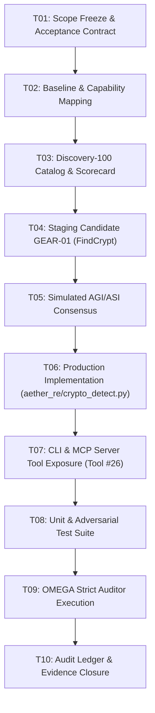

# ROTEIRO DE EXECUÇÃO DAG (EXECUTION ROADMAP)
**Protocolo:** ALPHA-C7 DISCOVERY-100
**Projeto:** AetherRE Megazord
**Data:** 2026-10-25

## Tarefas do Caminho Crítico

| Task ID | Descrição | Arquivos Afetados | Risco | Rollback | Status |
|---|---|---|---|---|---|
| **T01** | Congelamento de escopo v3.0.0 | `engineering_evidence/ACCEPTANCE_CONTRACT.md` | Zero | Reverter commit | **CONCLUÍDO** |
| **T02** | Mapeamento de capacidades e gaps | `EXISTING_CAPABILITY_MAP.md`, `TECHNOLOGY_GAP_MAP.md` | Zero | N/A | **CONCLUÍDO** |
| **T03** | Catálogo Discovery-100 & Scorecard | `DISCOVERY_100_CATALOG.csv`, `COMPONENT_SCORECARD.csv` | Zero | N/A | **CONCLUÍDO** |
| **T04** | Validação em staging de GEAR-01 | `external_component_candidates/selected/`, `STAGING_MANIFEST.md` | Zero | N/A | **CONCLUÍDO** |
| **T05** | Consenso AGI/ASI Simulado | `engineering_evidence/CONSENSUS_DECISION.md` | Baixo | N/A | **EM EXECUÇÃO** |
| **T06** | Implementação de `crypto_detect.py` | `aether_re/crypto_detect.py` | Baixo | `git checkout` | Próximo |
| **T07** | Exposição CLI & MCP (#26) | `megazord.py`, `aether_re/mcp_server.py` | Baixo | Reverter | Próximo |
| **T08** | Suíte de testes unitários & adversariais | `tests/test_crypto_detect.py`, `tests/test_empirical_megazord_auditor.py` | Baixo | Reverter | Próximo |
| **T09** | Certificação OMEGA Strict Auditor | `AetherMind_Strict_Auditor.py` | Zero | N/A | Próximo |
| **T10** | Fechamento do Ledger de Auditoria | `AUDIT_LEDGER_ROOT.json`, `ACCEPTANCE_MANIFEST.json` | Zero | N/A | Próximo |
